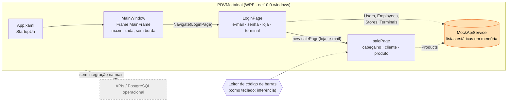
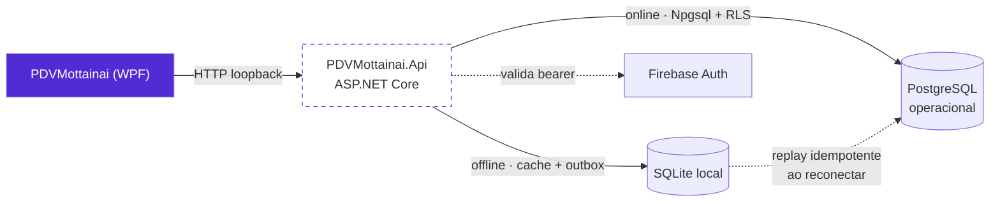
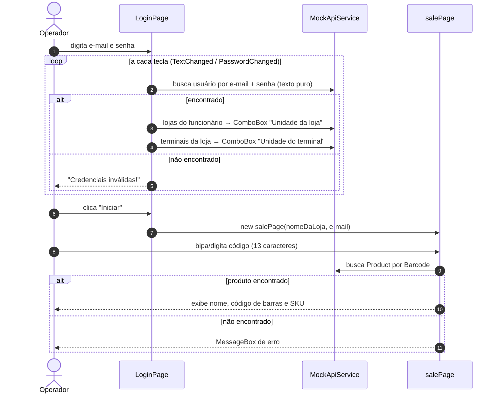
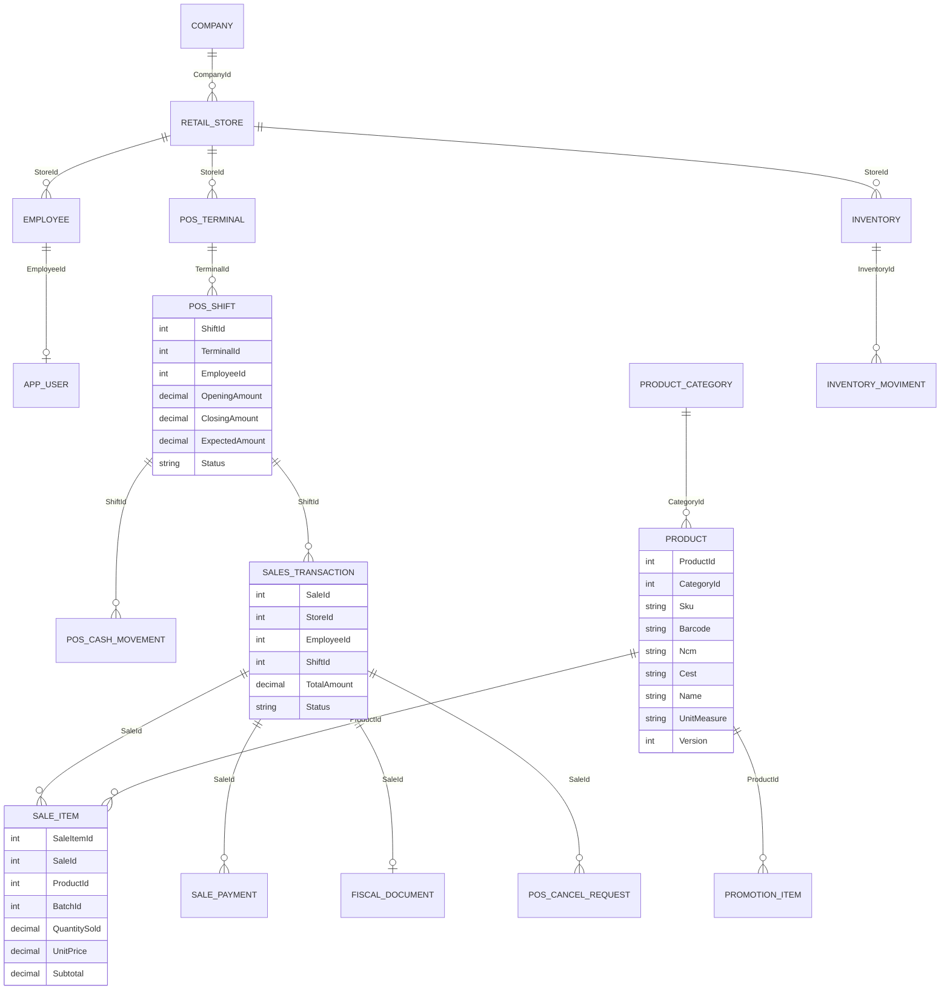
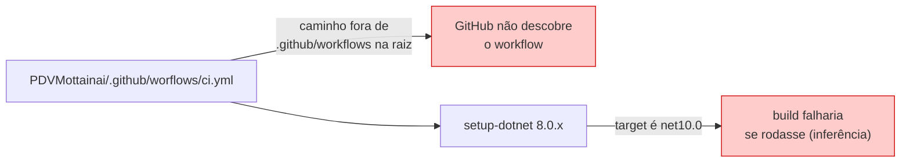

<div align="center">


# Mottainai POS (PDV Mottainai)

**Frente de caixa desktop do Mottainai: gestão preditiva de estoque para pequenos e médios varejos**

*Aplicação WPF em .NET 10 com login de operador, seleção de loja/terminal e leitura de código de barras. Na `main`, hoje é um protótipo de interface alimentado por dados mock em memória.*

<br/>

[](PDVMottainai/PDVMottainai.csproj)
[-512BD4?style=for-the-badge&logo=dotnet&logoColor=white)](PDVMottainai/PDVMottainai.csproj)
[](PDVMottainai/PDVMottainai.csproj)

[](PDVMottainai/Views)
[](PDVMottainai.slnx)
[](PDVMottainai/Services/MockApiService.cs)
[](#integração-contínua-testes-e-qualidade)
[](LICENSE)
[](#status-do-projeto)

<br/>

[Visão geral](#visão-geral) •
[Status](#status-do-projeto) •
[Arquitetura](#arquitetura) •
[Tecnologias](#tecnologias) •
[Estrutura](#estrutura-do-repositório) •
[Fluxos](#funcionalidades-e-fluxos) •
[Modelo de dados](#modelo-de-dados) •
[Como executar](#como-executar) •
[Integrações](#configuração-e-integrações) •
[CI e testes](#integração-contínua-testes-e-qualidade) •
[Riscos](#riscos-limitações-e-roadmap)

</div>

---

## Visão geral

O **Mottainai** (もったいない, expressão japonesa para *"que desperdício"*) é um sistema inteligente de gestão preditiva de estoque. Este repositório versiona o **POS / PDV** (ponto de venda): o aplicativo de caixa usado pelo operador da loja para identificar-se, escolher loja e terminal e registrar produtos por código de barras.

No ecossistema, o PDV é a **origem dos eventos de venda** que alimentam o banco operacional e, por consequência, o RPA, o BI e a IA. Na branch `main`, porém, essa ligação **ainda não existe**: nenhum dado sai do aplicativo.

| | O que é (fato, `main`) | O que **não** é (ainda) |
|---|---|---|
| **1** | Aplicativo desktop WPF (`OutputType` `WinExe`, `UseWPF`) para Windows | Não é API, serviço nem middleware de bipagem separado |
| **2** | Telas de **login** e **venda** em XAML com code-behind | Não há fechamento de venda, carrinho, total ou pagamento |
| **3** | Leitura de produto por **código de 13 dígitos** digitado ou bipado no campo | Não há SDK de leitor; o leitor só funcionaria como teclado (inferência) |
| **4** | 23 classes de modelo espelhando o domínio operacional | Não há persistência, ORM, HTTP nem banco |
| **5** | Dados vindos de `MockApiService` (listas estáticas em memória) | Não há integração real com as APIs ou com o PostgreSQL |

> [!NOTE]
> "Middleware de bipagem" foi uma hipótese do contexto do projeto. **Não confirmado no repositório**: na `main` a bipagem é apenas um `TextBox` dentro da tela de venda (`salePage.xaml`). Uma API local do PDV existe em outra branch, descrita em [Branches](#branches-e-trabalho-fora-da-main).

---

## Status do projeto

| Item | Status na `main` |
|---|:---:|
| Janela principal e navegação por `Frame` |  |
| Tela de login (e-mail, senha, loja, terminal) | -yellow?style=flat-square) |
| Tela de venda: cabeçalho e cards de cliente | -yellow?style=flat-square) |
| Consulta de produto por código de barras | -yellow?style=flat-square) |
| Carrinho, total, desconto, pagamento, finalização |  |
| Turno/caixa (abertura, sangria, suprimento, fechamento) |  |
| Documento fiscal e impressão de cupom |  |
| Integração com API / banco operacional |  |
| Testes automatizados |  |
| CI funcional |  |

> [!WARNING]
> Não há README na `main`, não há testes e o build **não foi executado nesta análise** (ambiente macOS; o target é `net10.0-windows`). Não use este aplicativo como PDV operacional.

---

## Arquitetura

### Arquitetura atual (`main`)



| Camada | Onde | Observação |
|---|---|---|
| Apresentação | `Views/*.xaml` + code-behind `*.xaml.cs` | Lógica de tela no code-behind; estilos locais por página |
| Navegação | `MainWindow.xaml` (`Frame`, `NavigationUIVisibility="Hidden"`) | Navegação por `Page` |
| Dados | `Services/MockApiService.cs` | Propriedades `static List<T>` com registros fictícios |
| Domínio | `Models/*.cs` | POCOs; só `RetailStore` implementa `INotifyPropertyChanged` |
| MVVM | Pastas `ViewModels\` e `Comands\` declaradas no `.csproj` | **Vazias**: MVVM planejado, não implementado |

### Arquitetura em desenvolvimento (fora da `main`)

A branch `feat/pos-api-implementation` propõe uma **API HTTP local por terminal** (loopback) entre o WPF e o PostgreSQL operacional, com cache e fila (outbox) em SQLite para operar offline. Isso **não está na `main`** e, segundo o próprio documento da branch, não foi validado contra Firebase/PostgreSQL reais.



<sub>Diagrama derivado de `docs/DECISAO-API-POS.md` e do `.csproj` da branch `feat/pos-api-implementation` (commit `4f66ccc`). A integração do WPF com essa API **não foi observada**.</sub>

---

## Tecnologias

<table>
<tr>
<td align="center" width="140"><br/><b>.NET 10</b><br/><sub><code>net10.0-windows</code><br/>(<code>.csproj</code>)</sub></td>
<td align="center" width="140"><br/><b>C#</b><br/><sub>Nullable e<br/>ImplicitUsings ativos</sub></td>
<td align="center" width="140"><br/><b>WPF + XAML</b><br/><sub>Páginas, Frame,<br/>estilos locais</sub></td>
<td align="center" width="140"><br/><b>Git</b><br/><sub>Solução em<br/>formato <code>.slnx</code></sub></td>
</tr>
<tr>
<td align="center" width="140"><br/><b>GitHub Actions</b><br/><sub>Workflow presente,<br/>mas <b>inativo</b></sub></td>
<td align="center" width="140"><br/><b>SQLite</b><br/><sub>Só na branch<br/>da API</sub></td>
<td align="center" width="140"><br/><b>PostgreSQL</b><br/><sub>Só na branch<br/>da API (Npgsql)</sub></td>
<td align="center" width="140"><br/><b>Firebase Auth</b><br/><sub>Só na branch<br/>da API (JWT)</sub></td>
</tr>
</table>

### Versões observadas

| Componente | Versão | Fonte | Branch |
|---|---|---|---|
| Target framework do WPF | `net10.0-windows` | `PDVMottainai/PDVMottainai.csproj` | `main` |
| SDK do projeto | `Microsoft.NET.Sdk` (`UseWPF=true`) | idem | `main` |
| Pacotes NuGet | **nenhum** | idem | `main` |
| .NET usado no workflow | `8.0.x` (diverge do target) | `PDVMottainai/.github/worflows/ci.yml` | `main` |
| `actions/checkout` / `actions/setup-dotnet` | `v4` / `v4` | idem | `main` |
| `Microsoft.AspNetCore.Authentication.JwtBearer` | `10.0.13` | `PDVMottainai.Api/PDVMottainai.Api.csproj` | `feat/pos-api-implementation` |
| `Microsoft.Data.Sqlite` | `10.0.14` | idem | `feat/pos-api-implementation` |
| `Npgsql` | `10.0.3` | idem | `feat/pos-api-implementation` |

---

## Estrutura do repositório

```text
Mottainai-POS/                          (branch main @ ac73da3)
├── LICENSE                             # MIT, 2026 Mottainai
├── PDVMottainai.slnx                   # Solução (1 projeto)
└── PDVMottainai/
    ├── .github/worflows/ci.yml         # Workflow em caminho errado: não é executado pelo GitHub
    ├── .gitignore                      # .vs/, bin/, obj/, *.user, *.suo
    ├── PDVMottainai.csproj             # WinExe, net10.0-windows, UseWPF
    ├── App.xaml / App.xaml.cs          # StartupUri = MainWindow.xaml
    ├── AssemblyInfo.cs                 # ThemeInfo padrão do template WPF
    ├── MainWindow.xaml / .cs           # Frame que navega para Views/LoginPage.xaml
    ├── Views/
    │   ├── LoginPage.xaml / .cs        # Login, seleção de loja e terminal
    │   └── salePage.xaml / .cs         # Tela de venda (cabeçalho, cliente, produto)
    ├── Services/
    │   └── MockApiService.cs           # Dados fictícios em listas estáticas
    ├── Models/                         # 23 POCOs do domínio (ver Modelo de dados)
    └── IMG/                            # 12 PNGs (logo, ícones, mascote)
```

<sub>49 arquivos versionados na `main`. As pastas `ViewModels\` e `Comands\` estão declaradas no `.csproj`, mas não existem no Git.</sub>

---

## Funcionalidades e fluxos

### Fluxo do operador



<details>
<summary><b>LoginPage: comportamento observado no código</b></summary>

<br/>

1. A validação roda **a cada alteração** de e-mail ou senha (`txtEmail_TextChanged`, `txtPasswordClose_PasswordChanged`), não só no clique.
2. A senha é comparada **em texto puro** com o campo `AppUser.PasswordHash` do mock (o comentário no próprio código reconhece que, num cenário real, estaria criptografado).
3. Botão de olho alterna entre `PasswordBox` e `TextBox` para mostrar/ocultar a senha.
4. `listStores` filtra funcionários com `e.StoreId == currentUserId`, ou seja, compara **ID de loja com ID de usuário**. O correto pelo modelo seria usar `AppUser.EmployeeId`. Funciona com o primeiro usuário mock apenas por coincidência de IDs.
5. `listTerminals` decide selecionar o primeiro terminal checando `Stores.Count` em vez de `Terminals.Count`.
6. O ComboBox de terminal usa `SelectedValuePath="StoreId"` (provavelmente deveria ser `TerminalId`), e o terminal escolhido **não é repassado** para a tela de venda.
7. `LogIn_Click` repassa só o nome da loja e o e-mail; se não houver loja selecionada, mostra *"Por favor, selecione uma loja."*.
8. "Esqueceu a senha?" e "Precisa de Ajuda?" são apenas texto: nenhum handler foi encontrado.

</details>

<details>
<summary><b>salePage: comportamento observado no código</b></summary>

<br/>

1. **Cabeçalho**: logo, `Loja: <nome>` e um campo de data/hora. O `DispatcherTimer` é criado, mas sem `Tick` nem `Start()` (o trecho funcional está comentado), então a data/hora **não é atualizada**.
2. **Nº da venda**: sempre `1`, porque o contador é uma variável local recriada a cada abertura da página.
3. **Cards de cliente** (CPF, nome, "nível do cliente", "Venda em andamento"): valores **fixos no XAML**, sem binding.
4. **Produto**: `TextBox formBarcode` com `MaxLength="13"`. Ao atingir 13 caracteres, busca em `MockApiService.Products` por `Barcode` e preenche nome, código de barras e SKU. Isso pressupõe EAN-13 (inferência); códigos EAN-8, UPC-A ou internos não seriam tratados.
5. O rótulo diz *"Código de barras (F3)"*, mas **não há atalho de teclado** (`KeyBinding`/`KeyDown`) no código.
6. Não há tratamento de `Enter`, comum em leitores configurados como teclado, nem limpeza do campo após a leitura.
7. Abaixo do produto há três linhas de placeholder (`Background` White/Blue/Black), a coluna direita é um card vazio e o rodapé tem 11 colunas com cards vazios (dois cards na coluna 7), ou seja, a área de itens e de ações ainda é **layout em construção**.

</details>

### Recursos de PDV: o que existe

| Recurso | Na `main` | Evidência |
|---|:---:|---|
| Login de operador | mock | `LoginPage.xaml.cs` + `MockApiService.Users` |
| Seleção de loja e terminal | mock, com bugs | `listStores`, `listTerminals` |
| Leitura de código de barras | mock | `formBarcode_TextChanged` |
| Integração com leitor (SDK, serial, HID dedicado) | não | nenhum pacote ou API de dispositivo |
| Carrinho, quantidade, total | não | apenas modelos `SaleItem`, `SalesTransaction` |
| Pagamento (TEF, PIX, dinheiro) | não | apenas modelo `SalePayment` |
| Cancelamento | não | apenas modelo `PosCancelRequest` |
| Turno e caixa | não | apenas modelos `PosShift`, `PosCashMovement` |
| NFC-e / SAT / cupom fiscal | não | apenas modelo `FiscalDocument` |
| Impressão | não | nenhuma referência a impressão no código |
| Promoções | não | apenas modelo `PromotionItem` |
| Operação offline | não | só proposta na branch da API |

---

## Modelo de dados

As classes em `PDVMottainai/Models` são POCOs sem atributos de mapeamento. Os nomes de campos (`*_id`, `CreatedAt`, `UpdatedAt`, `DeletedAt`, `Version`) indicam que **espelham o schema do banco operacional** do Mottainai (inferência; a branch da API cita tabelas como `pos_terminal`, `pos_shift`, `sales_transaction`, `sale_item` e `sale_payment` no repositório `Mottainai-Banco-Operacional`).



<sub>Relacionamentos inferidos pelos nomes das chaves; não há navegação nem FK declarada no C#.</sub>

<details>
<summary><b>Todas as 23 classes de modelo</b></summary>

<br/>

| Grupo | Classes |
|---|---|
| Organização | `Company`, `RetailStore`, `Employee`, `AppUser`, `Costumer` |
| Catálogo e estoque | `Product`, `ProductCategory`, `PromotionItem`, `Inventory`, `InventoryMoviment` |
| PDV e vendas | `PosTerminal`, `PosShift`, `PosCashMovement`, `PosCancelRequest`, `SalesTransaction`, `SaleItem`, `SalePayment`, `FiscalDocument` |
| Logs | `AuditLog`, `ErrorLog`, `InterationLog`, `JobLog`, `SystemLog` |

Observações:

- Grafias divergentes do domínio: `Costumer` (a propriedade é `CustomerId`), `InterationLog` (a propriedade é `IntegrationId`), `InventoryMoviment`; a pasta planejada se chama `Comands`.
- Todas são `internal`, exceto `RetailStore` (`public`, com `INotifyPropertyChanged`).
- Valores padrão de status em inglês e maiúsculas: `SalesTransaction.Status = "COMPLETED"`, `FiscalDocument.Status = "AUTHORIZED"`, `Inventory.InventoryType = "NORMAL"`.

</details>

---

## Como executar

### Pré-requisitos

- [ ] **Windows** (o target `net10.0-windows` com WPF não roda em macOS/Linux)
- [ ] **.NET SDK 10** com a carga de trabalho de desktop Windows
- [ ] Ferramenta que leia solução **`.slnx`** (Visual Studio ou `dotnet` CLI recentes; versão mínima não confirmada no repositório)

> [!IMPORTANT]
> Os comandos abaixo são o caminho padrão do .NET para este layout, **mas não foram executados nesta análise** (feita em macOS, sem `dotnet build`). Valide em uma máquina Windows antes de documentá-los como oficiais.

```bash
dotnet restore PDVMottainai.slnx
dotnet build PDVMottainai.slnx
dotnet run --project PDVMottainai/PDVMottainai.csproj
```

Ou abra `PDVMottainai.slnx` no Visual Studio e execute o projeto `PDVMottainai`.

### Uso com os dados mock

- O aplicativo abre **maximizado e sem barra de título** (`WindowState="Maximized"`, `WindowStyle="None"`). Não há botão de fechar visível; use o atalho do sistema (por exemplo `Alt+F4`).
- Os usuários, lojas, terminais e produtos de teste estão em `PDVMottainai/Services/MockApiService.cs`. Consulte o arquivo para as credenciais de teste; elas **não são reproduzidas aqui**.
- Para testar a busca de produto, use um dos valores de `Barcode` dos produtos mock (13 dígitos).

> [!WARNING]
> Possível falha de recursos em tempo de execução (**não confirmado sem build**): o `.csproj` declara como `Resource` apenas `inProgressIcon.png`, `otter.png` e `mottainai.png`, mas as telas carregam também `eyeOpenIcon.png`, `eyeCloseIcon.png`, `cartIcon.png` (referenciado como `CartIcon.png`), `documentIcon.png`, `userIcon.png`, `podiumIcon.png`, `searchIcon.png` e `copyIcon.png` via URI `pack://`. Se esses arquivos não forem incluídos como `Resource`, os ícones podem não aparecer ou o carregamento pode lançar exceção.

---

## Configuração e integrações

### Na `main`

| Item | Situação |
|---|---|
| `appsettings*.json` / `App.config` | **não existem** |
| Variáveis de ambiente | **nenhuma lida** pelo código |
| Connection strings | **nenhuma** |
| Chamadas HTTP | **nenhuma** (`MockApiService` só tem nome de API) |
| Banco de dados | **nenhum** |
| Dispositivos (leitor, impressora, gaveta, PinPad) | **nenhuma integração** |

### Na branch `feat/pos-api-implementation` (não mesclada)

Apenas **nomes** de chaves, sem valores:

| Arquivo | Chaves |
|---|---|
| `PDVMottainai.Api/appsettings.json` | `Api:Port`, `LocalStore:Path`, `Logging:LogLevel:Default`, `AllowedHosts` |
| `PDVMottainai.Api/appsettings.Development.json` | `Logging:LogLevel:Default` |
| Citadas em `docs/DECISAO-API-POS.md` | `Firebase:ProjectId`, `ConnectionStrings:Operational` (via variável de ambiente / secret manager, segundo o documento) |

<details>
<summary><b>Rotas da API local propostas (branch, não validadas)</b></summary>

<br/>

O documento de decisão fala em **24 rotas** agrupadas por domínio: autenticação (`/auth/login`, `/auth/refresh`, `/auth/logout`, `/auth/me`, `/auth/offline-login`, `/offline-sessions`), referência (`/terminals`, `/capabilities`, catálogo, promoções, cliente), turno e caixa (`/shifts`, `/shifts/{shiftId}/cash-movements`, `/cash-withdrawals`, `/cash-deposits`, fechamento) e vendas em rascunho (`/sales` e itens). O contrato estático está em `docs/API-POS.openapi.yaml` naquela branch.

Pontos declarados pelo próprio documento: bind em loopback, RLS no PostgreSQL via `SET LOCAL ROLE`, itens remotos em estado `DRAFT` sem reserva de estoque, fechamento de caixa **somente online**, preço promocional **não** aplicado offline, e: *"As migrations operacionais não foram aplicadas e os fluxos ainda não foram exercitados contra um ambiente Firebase/PostgreSQL autorizado."*

</details>

---

## Integração contínua, testes e qualidade



| Item | Situação |
|---|---|
| Workflow na `main` | `WPF CI` (`windows-latest`, `dotnet restore` + `dotnet build -c Release`), em `PDVMottainai/.github/worflows/ci.yml`. O GitHub só lê `.github/workflows/` **na raiz**, e a pasta está grafada `worflows`: o workflow **não é executado** |
| Versão do SDK no workflow | `8.0.x`, incompatível com `net10.0-windows` e possivelmente com `.slnx` |
| Workflow em outra branch | `ci/setup-github-actions` traz `.github/workflows/dotnet-desktop.yml` na raiz, mas **não foi mesclada** e diverge bastante da `main` (renomeia/remove ícones e reescreve as telas) |
| Testes | **nenhum** projeto de teste |
| Análise estática / formatação | nenhum `.editorconfig`, analyzer ou `Directory.Build.props` |
| `.gitignore` | só dentro de `PDVMottainai/`; projetos adicionados na raiz (como `PDVMottainai.Api`) precisam do próprio |

---

## Riscos, limitações e roadmap

### Riscos e limitações

| # | Risco | Impacto | Recomendação |
|:---:|---|---|---|
| 1 | **Nada persiste**: toda a "API" é `MockApiService` em memória | Nenhuma venda chega ao banco operacional, logo RPA, BI e IA não recebem dados do PDV | Integrar via API (a proposta da branch é um caminho) antes de qualquer demo de ponta a ponta |
| 2 | **Autenticação insegura no mock**: senha em texto puro, comparação a cada tecla e credenciais de teste triviais versionadas | Se o padrão migrar para produção, expõe operadores e permite força bruta trivial | Autenticar no backend (hash forte ou provedor de identidade), nunca no cliente |
| 3 | **Dados pessoais de aparência real versionados** (CPF e nome fixos no `salePage.xaml`; CPFs, e-mails e telefones no mock) | Risco LGPD se forem dados reais; ruim como exemplo | Usar geradores de dados sintéticos claramente fictícios e remover do XAML |
| 4 | **Bugs de lógica no login** (loja filtrada por ID de usuário, terminal com `SelectedValuePath` de loja, terminal não repassado) | Operador pode ver loja errada ou nenhuma; turno e venda não teriam terminal | Corrigir antes de ligar à API, junto com testes |
| 5 | **CI inexistente na prática** e **zero testes** | Regressões passam despercebidas; o build com `net10.0` nunca foi verificado em CI | Mover o workflow para `.github/workflows/`, usar SDK 10 e criar projeto de teste |
| 6 | **Código-behind sem MVVM** e EAN fixo em 13 dígitos | Dificulta teste, troca de fonte de dados e suporte a outros códigos (EAN-8, balança) | Adotar ViewModels/Commands (pastas já previstas) e validar o código no `Enter` |

### Roadmap sugerido

Itens derivados do que falta no código; não há roadmap formal no repositório.

- [x] Estrutura WPF com navegação por `Frame`
- [x] Telas de login e venda (layout)
- [x] Modelos do domínio operacional
- [x] Consulta de produto por código de barras (mock)
- [ ] Corrigir os bugs de login e o carregamento de ícones
- [ ] Carrinho, total, pagamento e finalização da venda
- [ ] Abertura e fechamento de turno, sangria e suprimento
- [ ] Integração com a API local do PDV (`feat/pos-api-implementation`) e o banco operacional
- [ ] Documento fiscal e impressão
- [ ] CI funcional e testes automatizados

---

## Branches e trabalho fora da `main`

| Branch remota | Último commit | Conteúdo em relação à `main` |
|---|---|---|
| `main` | `ac73da3` (2026-09-16) | Estado documentado neste README |
| `feat/pos-api-implementation` | `4f66ccc` (2026-10-27) | +24 arquivos: projeto `PDVMottainai.Api` (ASP.NET Core, SQLite, Npgsql, JWT), OpenAPI e documento de decisão |
| `docs/readme-standardization` | `5dd6d0c` (2026-10-26) | Cria um `README.md` curto (não mesclado) |
| `ci/setup-github-actions` | `47b6298` (2026-09-13) | Workflow `dotnet-desktop.yml` na raiz, mas com versão antiga das telas e ícones |
| `feature/Add-LoginPage`, `feature/Add-salePage`, `feature/Create-actions`, `feature/models-database` | não analisadas | Branches de feature, aparentemente já incorporadas à `main` via merges (PR #5 observado no histórico) |

> [!NOTE]
> O histórico da `main` tem 22 commits, de 2026-09-02 a 2026-09-16, todos no padrão `feat:`, com merges de PR e commits feitos por bot.

---

<details>
<summary><b>Nota de rastreabilidade</b></summary>

<br/>

- **Repositório:** `Mottainai-One/Mottainai-POS`
- **Branch e commit analisados:** `main` @ `ac73da3` (*feat: Adjust header informations*, 2026-09-16)
- **Data da análise:** 2026-10-27
- **Arquivos consultados na `main`:** `LICENSE`, `PDVMottainai.slnx`, `PDVMottainai/PDVMottainai.csproj`, `PDVMottainai/.gitignore`, `PDVMottainai/.github/worflows/ci.yml`, `App.xaml`, `App.xaml.cs`, `AssemblyInfo.cs`, `MainWindow.xaml`, `MainWindow.xaml.cs`, `Views/LoginPage.xaml`, `Views/LoginPage.xaml.cs`, `Views/salePage.xaml`, `Views/salePage.xaml.cs`, `Services/MockApiService.cs`, os 23 arquivos de `Models/` e a listagem de `IMG/`; além de `git ls-files`, `git log` e `git ls-remote`.
- **Outras branches (somente leitura, via `git fetch --depth 20`):** `feat/pos-api-implementation` (`PDVMottainai.Api/PDVMottainai.Api.csproj`, `appsettings*.json` só nomes de chaves, `Program.cs`, `docs/DECISAO-API-POS.md`, `docs/API-POS.openapi.yaml`), `ci/setup-github-actions` e `docs/readme-standardization` (apenas `diff --stat`).
- **Não executado:** `dotnet restore/build/run`, testes e o aplicativo. Afirmações de runtime estão marcadas como inferência ou "não confirmado".
- **Segredos:** nenhum valor de credencial, CPF ou dado pessoal foi reproduzido; apenas nomes de arquivos e chaves.

</details>

<div align="center">

**Mottainai** · *menos desperdício, mais inteligência no estoque*

<sub>Parte do ecossistema <a href="https://github.com/Mottainai-One">Mottainai-One</a> · Licença <a href="LICENSE">MIT</a></sub>

</div>
